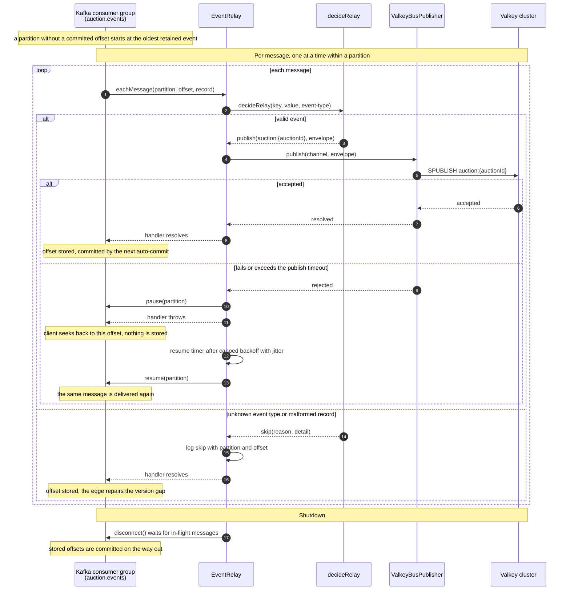

# Realtime Gateway

Status: proposed. Implemented so far: the auction-service prerequisites, the
local and CI Valkey cluster, and the relay (slices 1 to 3).

The realtime gateway streams committed auction changes to clients over
Server-Sent Events (SSE). It is a read-side delivery system. It never decides
whether a bid is valid, and it is never the source of auction truth: whatever
it shows can always be rebuilt from `auction-service`.

## Goals and non-goals

Goals:

- Scale **event volume** and **connection fan-out** independently, so that
  neither is limited by the size of one machine.
- Survive a hot auction watched by hundreds of thousands of clients.
- Give clients a per-auction stream that is either contiguous or explicitly
  resynchronized, so a client never silently shows a stale price.
- Make every loss path observable and repaired by a resync, not by hope.

Non-goals for this milestone:

- Durable per-client history or replay. Clients get the current state plus
  live changes, not a bid log.
- Private auctions and authenticated streams (see
  [Open questions](#open-questions)).
- Proxy/max bidding and finalization events. The design leaves room for them.

## Topology

```text
                    auction.events (12 partitions, key = auctionId)
                                     │
                                     │  consumer group "realtime-relay"
                                     ▼
                ┌──────────── realtime relay × N (N ≤ partitions) ────────────┐
                │ validate contract → bus envelope → SPUBLISH → commit offset │
                └─────────────────────────────┬───────────────────────────────┘
                                              │  channel auction:{auctionId}
                                              ▼
                              Valkey (sharded pub/sub, cluster mode)
                                              │  SSUBSCRIBE only to auctions
                                              │  that local clients watch
                                              ▼
            ┌──────────────── SSE edge × M (scales with connections) ────────┐
            │ per-auction state + version check → fan out to local clients   │
            │ first watcher / gap / reconnect → bulk live-state read ────────┼──► auction-service
            └──────────────────────────────┬─────────────────────────────────┘      GET live state
                                           │  one multiplexed SSE connection
                                           ▼  per client
                                        clients
```

`realtime-gateway` stays **one service with two entry points**, `relay` and
`edge`, deployed and scaled as separate processes. This mirrors how
`auction-service` ships its outbox publisher: the processes are independent,
but the domain (the bus envelope, the live-state model, the version rules) is
owned by one package and changes together.

| Process | Scales with                                      | State                                             | Upper bound                         |
| ------- | ------------------------------------------------ | ------------------------------------------------- | ----------------------------------- |
| relay   | Event volume (messages/s across all auctions)    | None beyond Kafka committed offsets               | Partition count of `auction.events` |
| edge    | Connections and auctions watched on that machine | In-memory state of the auctions its clients watch | Load balancer, Valkey shard fan-out |

### Why not simpler topologies

- **Every instance consumes every partition.** Connection capacity scales,
  event capacity does not: every instance pays for the whole topic.
- **Route each client to the instance owning its auction's partition.** A
  client watching several auctions needs several instances, every consumer
  rebalance disconnects clients, and a hot partition becomes a hot machine.
- **Edges assign themselves only the partitions they need.** A partition holds
  about 1/12 of all auctions, so a few hundred varied subscriptions require
  every partition, which collapses back into the first option.

Kafka is the right tool for durable, ordered, replayable event volume. It is
the wrong tool for fan-out to a dynamic set of connections. The two tiers give
each problem its own tool.

## Guarantees in one paragraph

Every event that Kafka holds is forwarded to Valkey **at least once** by the
relay, in partition order, before its offset is committed. Valkey pub/sub is
**at most once**, but every way it loses a message also drops or resets the
edge's subscription, and the edge resynchronizes every affected auction from
`auction-service` when that happens. Edges apply an auction's events only in
contiguous version order: duplicates and late copies are dropped, and a gap
triggers a resync. A client therefore receives, per auction, a `snapshot`
followed by contiguous changes, or a fresh `snapshot` that replaces what it
had. Freshness is not guaranteed: when a relay lags or is down, clients see
correct but old state until it catches up (see
[Failure scenarios](#failure-scenarios)).

## Prerequisites in auction-service

### 1. Contiguous auction versions

Gap detection only works if **every change to `auctions.version` emits exactly
one outbox event carrying the new version**, and versions only ever increase by
one. Then an edge that holds version `v` and receives `v + 2` knows it missed
something.

Today this holds by convention: auction creation starts at version 1 without
an event (the snapshot is the baseline), and bid acceptance increments the
version and appends `BidAccepted.v1`. The existing
`outbox_events_current_auction_version` trigger guarantees that an event
carries the current version. It does not guarantee the reverse, so a future
cancellation that bumped the version without an event would silently break
every consumer's gap detection.

Enforcement (implemented in
`20260929120000_auction__enforce_contiguous_versions.sql`):

- A `BEFORE UPDATE OF version` trigger on `auctions` that rejects any change
  other than `NEW.version = OLD.version + 1`.
- A `DEFERRABLE INITIALLY DEFERRED` constraint trigger `AFTER UPDATE OF
version` that, at commit, requires an `outbox_events` row with
  `(auction_id, auction_version) = (NEW.id, NEW.version)`.

Both are cheap, since the outbox row is found through the existing
`outbox_events_auction_version_key` index. The invariant is documented in
`AUCTION_LIFECYCLE.md` as a rule for every future writer, next to the existing
"every externally visible aggregate mutation increments `version`".

### 2. A consistent live-state read

`GET /v1/auctions/:id` returns `version` but not the leading bid, so it cannot
serve as a snapshot of what clients display. Implemented as:

```text
GET /v1/auctions/live-states?ids=1,2,3        (1–100 ids, public, like other auction reads)
```

```json
{
  "items": [
    {
      "auctionId": "42",
      "auctionVersion": "17",
      "currencyCode": "EUR",
      "startsAt": "2026-10-01T10:00:00.000Z",
      "endsAt": "2026-10-01T12:00:00.000Z",
      "cancelledAt": null,
      "closedAt": null,
      "phase": "open",
      "leadingBid": { "bidId": "901", "amountMinor": "12500" }
    }
  ],
  "missingIds": ["43"],
  "observedAt": "2026-10-01T11:02:03.123Z"
}
```

It must read the version and the leading bid in **one statement**
(`auctions LEFT JOIN bids ON bids.id = auctions.leading_bid_id`), so both come
from the same MVCC snapshot. Two separate reads could pair version 17 with the
leading bid of version 18, and the edge would then drop the real version 18
event as a duplicate while showing its effect under the wrong version.

It is a bulk endpoint because resyncs happen in bursts: an edge whose Valkey
connection drops must refresh every auction it serves at once.

## Relay

Status: implemented in `services/realtime-gateway/src/relay/` and run by
`relay.main.ts`.

A Kafka consumer in group `realtime-relay`, using the promisified
`@confluentinc/kafka-javascript` API like the outbox publisher.

The sequence below shows one relay process: how each message is forwarded or
skipped, what happens when a publish fails, and how it shuts down. The numbered steps are explained in the rest of this
section.



Per message, in partition order:

1. Read the `event-type` header. A type without a relay contract is logged at
   `warn` and skipped. New event types are added to the relay before producers
   emit them.
2. Parse the value with the contract parser, for example `parseBidAcceptedV1`,
   and check that the record key equals the event's `auctionId`.
3. Wrap it in the bus envelope and `SPUBLISH` it to `auction:{auctionId}`.
4. Return from the handler, which marks the offset as processed.

**Acknowledgement boundary.** The Kafka client stores a message's offset only
after its handler resolves, and librdkafka's auto-commit (every
`RELAY_COMMIT_INTERVAL_MS`, and when partitions are revoked or the consumer
closes) commits only stored offsets. The handler resolves after the bus has
accepted the publish or the record was skipped, so an offset is never
committed ahead of its publish. This is the same guarantee as committing by
hand after each publish, without a commit request per message. A crash between
publish and commit publishes again when the partition resumes, which the edges
drop as `v ≤ c`. The process test demonstrates exactly this sequence.

**A malformed event is skipped, not retried.** This is the opposite of the
outbox publisher, which blocks an auction on an event that cannot be
published. The difference is deliberate: the outbox is the only path to Kafka,
so dropping an event there loses it. The relay is a display path with an
authoritative fallback. Skipping creates a version gap, which the edge repairs
from `auction-service` when the next event of that auction arrives. Blocking
would freeze every auction on the partition. Malformed means a missing
`event-type` header or value, invalid JSON, a payload that breaks its
contract (which includes a header that disagrees with the payload's type), or
a key that differs from the event's `auctionId`, because the key decides the
partition and so the order edges rely on. The skip is logged at `error` with
the partition, offset, key, `eventId`, and reason.

**A failed publish pauses its partition.** The relay pauses the partition,
throws, and the client seeks back to the failed message. A timer resumes the
partition after the same capped exponential backoff with jitter as the outbox
publisher, and the message is delivered again. Pausing, instead of waiting
inside the handler, keeps the consumer polling, so a long Valkey outage never
exceeds `max.poll.interval.ms` and evicts the relay from the group. Other
partitions keep flowing if they can publish. Publishes are bounded by
`RELAY_PUBLISH_TIMEOUT_MS`: node-redis queues commands while a node
reconnects, and without the bound a publish could wait indefinitely.

| Setting                          | Value                            | Reason                                                                                                                                                                                                                                                             |
| -------------------------------- | -------------------------------- | ------------------------------------------------------------------------------------------------------------------------------------------------------------------------------------------------------------------------------------------------------------------ |
| `partition.assignment.strategy`  | `cooperative-sticky`             | A rebalance moves only the partitions that must move; other relays keep forwarding.                                                                                                                                                                                |
| `auto.offset.reset`              | `earliest`                       | A partition without a usable committed offset starts at the oldest retained event, so no event is skipped; see [offset resets](#offset-resets).                                                                                                                    |
| `enable.auto.commit`             | `true`, of stored offsets only   | The client stores an offset only after its handler resolved; see the acknowledgement boundary above. `enable.auto.offset.store` is always `false` in this client's promisified API.                                                                                |
| `session.timeout.ms`             | `RELAY_SESSION_TIMEOUT_MS`, 10 s | How long a crashed relay keeps its partitions before the group reassigns them, and so how long their live updates stall. Lower than librdkafka's 45 s default because a relay is cheap to replace; the broker's `group.min.session.timeout.ms` (6 s) is the floor. |
| `partitionsConsumedConcurrently` | `RELAY_PARTITION_CONCURRENCY`, 4 | Partitions handled in parallel by one process. Each partition is still handled one message at a time.                                                                                                                                                              |

### Offset resets

A partition has no usable committed offset when the group is new, when the
broker expired the group's offsets (after it was empty for longer than
`offsets.retention.minutes`, 7 days by default), or when the committed offset
points at records that retention already deleted. `auto.offset.reset =
earliest` then starts the relay at the oldest retained event.

- **New or expired group:** the relay replays the retained history (up to the
  topic's 7 days) through Valkey once. Edges drop every event at or below the
  version they already hold, so the replay costs bus traffic, not
  correctness. A new relay group is rare: groups are long-lived, and scaling
  adds members to the existing group.
- **Retention deleted unread events:** those events are gone, so the relay
  continues from the oldest one left. This is the one way the relay skips
  events. Edges notice the version gap on the next event of each affected
  auction and resync it. An auction with no later event stays stale until its
  edge refreshes for another reason, for example a restart. It requires the
  relay group to fall more than the topic's retention behind, an outage an
  operator would already be handling. An integration test pins this behavior
  down.

An earlier version started new groups at the latest offset instead, to avoid
the replay. Every reset then skipped events, so the relay had to detect resets
(committed offsets read in the rebalance callback, and a continuity check on
the first message) and broadcast a resync to every edge on a control channel.
Starting at `earliest` removes that machinery at the cost of the occasional
replay.

**Ordering.** Valkey delivers the messages of one channel in the order one
connection published them. The relay publishes a partition's messages in order,
over one connection per Valkey shard, and a partition is processed by one relay
at a time. A rebalance can briefly let the old and new owners overlap. The edge
version check handles the duplicates and reordering this causes.

## Bus

**Channel:** `auction:{auctionId}`, one per auction.

**Why sharded pub/sub.** In cluster mode, classic `PUBLISH` is broadcast to
every node in the cluster, so adding shards adds cost instead of capacity.
Sharded pub/sub (`SPUBLISH`/`SSUBSCRIBE`, Redis 7.0+ and every Valkey release) routes a channel to the
shard that owns its hash slot, like a key. Throughput then scales with shards,
and a hot auction loads one shard, not the cluster.

### Engine and client decision

Status: decided.

| Choice       | Decision                                                                                            |
| ------------ | --------------------------------------------------------------------------------------------------- |
| Engine       | **Valkey**, cluster mode. Locally `valkey/valkey:9.0.6`; in AWS, ElastiCache for Valkey 9.0.        |
| Relay client | **node-redis** (`redis` 6.x) cluster client: `sPublish` routes by channel slot and follows `MOVED`. |
| Edge client  | **node-redis standalone clients, one per primary**, managed by the gateway's own shard subscriber.  |

**Why Valkey.** Both engines speak the same protocol, and this design uses only
sharded pub/sub, `CLUSTER SHARDS`, and `CLIENT KILL`. The deciding factors are
where each runs on AWS and its license. ElastiCache's Redis OSS engine stopped
at 7.1, while current releases ship as Valkey: AWS announced ElastiCache for
Valkey 9.0 in May 2026. Valkey is BSD-licensed, and Redis 8 is not. Matching
the local image to the managed engine version follows the same rule as
PostgreSQL and RDS. Sharded pub/sub and `CLUSTER SHARDS` have been in the
engine since 7.0 and are available in every Valkey release.

**Why not the cluster subscriber of a client library.** The edge's correctness
depends on one property: **every interruption of a subscription must reach
our code, naming the affected channels**, so that the edge can resync them.
Inspecting the published packages (node-redis 6.2.1, ioredis 6.0.0, Valkey
GLIDE 2.5.3) showed that none of them guarantee this:

- **ioredis** (`shardedSubscribers: true`) handles slot migration and
  reconnects internally, reports only group-level `+subscriber`/
  `-subscriber`/`subscribersReady` events without channels, and swallows
  resubscribe failures (they are logged only through its debug output).
- **Valkey GLIDE** reconciles desired and actual subscriptions in the
  background (`pubsubReconciliationIntervalMs`). Recovery is automatic, but
  nothing reports that messages were missed in between. It also ships a native
  Rust binary per platform.
- **node-redis cluster** moves channels to the new owner internally. It
  reports a failed move (`sharded-channel-moved-error`) but not a successful
  one, so messages published between the migration and the resubscription
  disappear silently.

All three recover the subscription; none report the gap in delivery. Automatic
recovery is the right default for a cache client, but here it is exactly the
hidden behavior that `AGENTS.md` asks us to make explicit.

node-redis still wins over ioredis for this role. Its standalone client reports
what we need at the connection level: `reconnecting`, `ready`, and `end`
events, plus a per-channel `sharded-channel-moved` event when the server sends
an unsolicited `sunsubscribe`. It is also the client Redis maintains, with
first-class TypeScript types. It is not the client Valkey maintains; the
features used here are protocol basics, so divergence is a low risk, and the
integration tests run against Valkey.

**The relay does not need any of this.** A lost publish surfaces as a command
error, which the relay already retries without committing the offset.

**Envelope**, owned by `realtime-gateway` (it is internal to the service, so it
does not belong in `packages/contracts`):

```json
{
  "v": 1,
  "eventType": "BidAccepted.v1",
  "event": {
    "eventId": "…",
    "auctionId": "42",
    "auctionVersion": "18",
    "bidId": "902",
    "amountMinor": "13000",
    "currencyCode": "EUR",
    "occurredAt": "…"
  }
}
```

Pub/sub has no headers, so the event type travels in the envelope.

**Loss is observable.** On a healthy connection, Valkey pub/sub does not drop
messages. It loses them only in situations the subscriber can see:

| Cause                                                       | What the edge observes                                   |
| ----------------------------------------------------------- | -------------------------------------------------------- |
| Network failure or Valkey restart                           | Connection closed; the client library reconnects.        |
| Edge too slow: `client-output-buffer-limit pubsub` exceeded | Valkey closes the connection.                            |
| Shard failover                                              | Connection to the old primary closes.                    |
| Slot migration during resharding                            | Valkey sends `sunsubscribe` for the channels that moved. |

Every row ends in a resubscription, and the edge resyncs every auction on the
affected connection afterwards. This property is the reason at-most-once
delivery on the bus is acceptable.

The edge does not trust any single signal for this, because the signals are
imperfect. In particular, node-redis recognizes an unsolicited `sunsubscribe`
only while no other command awaits a reply; if it arrives while an
`SSUBSCRIBE` is in flight, which is common on a busy edge, it can be taken as
that command's reply. The shard subscriber below therefore also compares the
cluster topology periodically, which catches any slot move that a push
message did not report.

## Edge shard subscriber

The edge owns its subscriptions directly instead of delegating them to a
cluster client:

- **Slot map.** On startup, and whenever a trigger below fires, the edge reads
  `CLUSTER SHARDS` and records which primary owns each hash slot. Each channel's
  slot is computed with the standard CRC16 key-slot function.
- **One connection per primary.** Each is a node-redis standalone client in
  subscriber mode. It carries the `SSUBSCRIBE`s for the watched auctions whose
  slots that primary owns.
- **Per-connection generation.** A connection's generation increments whenever
  its subscriptions may have been interrupted. Channels subscribed in an older
  generation are resynced.

| Trigger                                                          | Response                                                                                                                     |
| ---------------------------------------------------------------- | ---------------------------------------------------------------------------------------------------------------------------- |
| Connection `end` or `reconnecting`                               | Mark every auction on it `syncing`. On `ready`, refresh the slot map, resubscribe each channel at its current owner, resync. |
| `sharded-channel-moved` for a channel                            | Refresh the slot map, subscribe at the new owner, resync that auction.                                                       |
| `MOVED` reply to an `SSUBSCRIBE`                                 | Same as a moved channel.                                                                                                     |
| Periodic `CLUSTER SHARDS` (default every 5 s) shows a slot moved | Treat every watched auction in that slot as moved.                                                                           |
| A primary disappears or a new one appears                        | Close or open its connection, and treat its channels as moved.                                                               |

The periodic comparison bounds how long a missed signal can go unnoticed: at
most one interval, and in practice only until the next event of that auction
reveals the gap. Resharding and failover are rare, operator-visible events, so
this is cheap insurance. It costs one small command per edge per interval.

The shard subscriber is the most intricate new code in the gateway. It is kept
small and is tested directly against a local Valkey cluster: killing a
connection, migrating a slot with `CLUSTER SETSLOT`, and failing over a
primary.

## Edge

### Per-auction state

For each auction that at least one local client watches, the edge keeps:

- `status`: `syncing` or `live`.
- `version` and the live state (phase facts and leading bid).
- A buffer of events received while `syncing`.
- The set of local client connections watching it.

### Subscribing to an auction

When the first local client asks for an auction:

1. `SSUBSCRIBE auction:{id}` and wait for the confirmation. Buffer everything
   that arrives from now on.
2. Fetch the live state (version `V`) through the bulk endpoint. Requests from
   many first-time subscriptions are batched for a few milliseconds, and
   concurrent requests for the same auction share one fetch.
3. Apply the buffered events with version `> V` using the rule below, then mark
   the auction `live`.

The order matters: subscribing **before** reading means an event committed
during the read is either already reflected in `V` or buffered. Reading first
would leave a window in which an event is neither.

Later clients of the same auction are served from memory without calling
`auction-service`. For a hot auction watched by 500k clients across 50 edges,
this costs 50 live-state reads, not 500k.

When the last local client leaves, the edge waits a linger period (default
30 s) before `SUNSUBSCRIBE` and dropping the state, so clients switching pages
do not cause subscription churn.

### Applying an event

With current version `c` and incoming version `v`:

| Condition   | Meaning                                                        | Action                                       |
| ----------- | -------------------------------------------------------------- | -------------------------------------------- |
| `v ≤ c`     | Duplicate, or a late copy (see the outbox's `v, v+1, v` case). | Drop and count.                              |
| `v = c + 1` | The next change.                                               | Apply and fan out to local clients.          |
| `v > c + 1` | Gap: a skipped malformed event, a lost message, or reordering. | Resync the auction; buffer until it is done. |

A resync fetches the live state again, sets `c` to its version, applies the
buffered events that are still newer, and sends every watching client a fresh
`snapshot`. If the delayed event arrives afterwards, it is dropped as `v ≤ c`.

### Resync triggers

- A gap, for one auction.
- Any trigger of the [shard subscriber](#edge-shard-subscriber), for every
  auction whose subscription may have been interrupted.

Mass resyncs go through the bulk endpoint with bounded concurrency and jitter,
so that a Valkey failover, which hits every edge at once, does not turn into a
read storm on `auction-service`.

### Fan-out

An event is serialized into its SSE frame once per edge, then written to every
watching connection. Serialization cost is per edge, not per client.

## Client protocol

```text
GET /v1/stream?auctions=42,77,103
Accept: text/event-stream
```

- Public, like auction reads today. At most 50 auctions per connection (a
  configurable limit). Malformed or too many ids return `400` before the
  stream starts.
- One connection carries every subscription, as `ARCHITECTURE.md` requires.
  **Changing the set means opening a new connection.** A separate "add a
  subscription" request would have to reach the same edge as the stream, which
  requires sticky routing and couples clients to specific machines. Reconnecting
  is cheap because the edge usually has the auctions in memory.

Messages:

```text
event: snapshot
data: {"auctionId":"42","auctionVersion":"17","phase":"open","endsAt":"…","leadingBid":{"bidId":"901","amountMinor":"12500"},"currencyCode":"EUR","serverTime":"…"}

event: bid-accepted
data: {"auctionId":"42","auctionVersion":"18","bidId":"902","amountMinor":"13000","currencyCode":"EUR","occurredAt":"…"}

event: unavailable
data: {"auctionId":"43","reason":"not-found"}

: heartbeat
```

- On every connect, the edge sends one `snapshot` per auction, then changes.
  SSE `id:` fields and `Last-Event-ID` are not used, because a new connection
  always starts from snapshots.
- **Client rule:** keep one version per auction and apply any message whose
  version is greater than it. A `snapshot` replaces the state. The server only
  ever sends contiguous changes or a snapshot, so the client needs no gap
  logic of its own.
- `serverTime` lets clients compute countdowns without trusting their own
  clock.
- A heartbeat comment every 15 s keeps load balancers (the AWS ALB idle timeout
  defaults to 60 s) and proxies from closing quiet streams.

### Slow clients

Each connection has a bound on unwritten bytes. When a client exceeds it, the
edge **conflates**: it discards that connection's queued frames, marks the
affected auctions as dirty, and once the socket drains it sends one current
`snapshot` per dirty auction. The client skips intermediate prices but never
shows a wrong one, and a slow reader cannot grow the edge's memory. A
connection that stays over the bound past a timeout is closed, and the client
reconnects.

## Failure scenarios

| Scenario                                             | What happens                                                                                                                                                                        | Client sees                                                                     |
| ---------------------------------------------------- | ----------------------------------------------------------------------------------------------------------------------------------------------------------------------------------- | ------------------------------------------------------------------------------- |
| Kafka delivers an event 5 times                      | The relay forwards each copy. The edge applies the first and drops the rest (`v ≤ c`).                                                                                              | One change.                                                                     |
| Outbox late duplicate `v, v+1, v`                    | The edge drops the second `v`.                                                                                                                                                      | `v`, `v+1`.                                                                     |
| Relay crashes after `SPUBLISH`, before commit        | Its partitions stall until the group's session timeout (`RELAY_SESSION_TIMEOUT_MS`) expires; then another relay re-reads from the committed offset and publishes again.             | Nothing extra; edges drop the duplicates.                                       |
| Relay publishes `v+1` before `v` (rebalance overlap) | The edge sees a gap, resyncs, then drops `v` when it arrives.                                                                                                                       | A `snapshot` at `v+1` or later.                                                 |
| Malformed event on the topic                         | The relay logs and skips it. The next event of that auction reveals the gap.                                                                                                        | A `snapshot` once the auction changes again.                                    |
| All relays down, or lagging                          | Nothing is published. Edges keep serving their last state. When relays recover they forward the backlog in order, and edges drop what is already reflected.                         | Correct but stale state, then the missed changes in order.                      |
| Relay group new, or its offsets expired              | The relay replays the retained history from the oldest event. Edges drop what they already reflect.                                                                                 | Nothing extra; possibly duplicates, which edges drop.                           |
| Retention deleted events the relay had not read      | The relay continues from the oldest retained event; those events are skipped.                                                                                                       | A `snapshot` once each affected auction changes again; until then, stale state. |
| Valkey unavailable                                   | Relays pause and stop committing. Edges lose their subscriptions and keep retrying. When Valkey returns, edges resubscribe and resync, and relays forward the backlog.              | Stale state during the outage, then `snapshot`s.                                |
| One Valkey shard fails over                          | Connections to that shard drop. Edges resync the auctions on it; relays retry publishes to it.                                                                                      | A `snapshot` for the affected auctions.                                         |
| Valkey resharding moves a slot                       | Edges learn of it from `sunsubscribe`, a `MOVED` reply, or the periodic topology check, resubscribe at the new owner, and resync those auctions.                                    | A `snapshot` for the affected auctions.                                         |
| Edge too slow for Valkey                             | Valkey closes the edge's connection; the edge reconnects and resyncs.                                                                                                               | A `snapshot` per watched auction.                                               |
| `auction-service` unavailable during a resync        | The auction stays `syncing` and its events stay buffered, with a bound. Fetches retry with backoff. On buffer overflow the buffer is discarded, since the fetch replaces it anyway. | Last good state, no changes until the fetch succeeds.                           |
| An edge crashes                                      | Its clients reconnect through the load balancer to other edges, which serve memory or fetch in bulk.                                                                                | A reconnect, then `snapshot`s.                                                  |
| Rolling edge deploy                                  | A draining edge stops accepting connections and closes existing ones spread over a drain window, so clients do not all reconnect at the same instant.                               | A reconnect, then `snapshot`s.                                                  |
| Slow client                                          | The edge conflates that connection.                                                                                                                                                 | Skipped intermediate prices, then current `snapshot`s.                          |

**Known limitation:** an edge cannot tell a quiet auction from a stalled relay.
Clients see correct but possibly old state without an indication of it. A later
step can add relay heartbeats that report each partition's position, so edges
can mark the stream as degraded.

## Scaling characteristics

| Pressure                       | Scales with                                       | Limit and next step                                                                                                            |
| ------------------------------ | ------------------------------------------------- | ------------------------------------------------------------------------------------------------------------------------------ |
| Total events/s                 | Relays, up to 12 partitions                       | Partition count. Adding partitions remaps keys and is a deliberate operation (see `README.md`).                                |
| One hot partition              | Nothing: one relay serves one partition           | The relay's per-message work is small, so the ceiling is high. Measuring it is the ACCEPTANCE.md hot-partition exercise.       |
| Total connections              | Edges                                             | Memory and file descriptors per edge; the load balancer's connection limits.                                                   |
| One hot auction, many watchers | Edges: one Valkey message per edge, local fan-out | The Valkey shard owning the channel carries `bids/s × subscribed edges`. At 100 bids/s and 50 edges, that is 5,000 messages/s. |
| Many distinct watched auctions | Valkey shards (channels spread by hash slot)      | Subscription count per edge connection.                                                                                        |
| Resync bursts                  | Bulk reads, batching, shared fetches              | `auction-service` read capacity; read replicas later.                                                                          |

## Testing

Integration tests against real Kafka, Valkey, and PostgreSQL from the root
`docker-compose.yml`, in the same style as the outbox publisher tests.

- End to end: a bid accepted over HTTP reaches an SSE client as
  `bid-accepted` with the right version.
- The same event delivered 5 times reaches the client once.
- `v, v+1, v` delivers `v` and `v+1` only.
- `v+1` before `v` triggers a resync and ends at the correct state.
- An event committed while the first subscriber's live-state read is in
  flight is applied exactly once (a gate holds the read).
- Killing the edge's Valkey connection (`CLIENT KILL TYPE pubsub`) during
  publishing ends with every client at the correct version.
- Migrating a watched auction's slot to another primary (`CLUSTER SETSLOT`)
  ends with every client at the correct version, including when the
  `sunsubscribe` push is missed and only the periodic topology check sees it.
- Valkey down at the relay: no offset is committed, and every event arrives
  after recovery.
- A malformed event is skipped, logged, and committed; the next event of that
  auction causes a resync.
- A new group forwards events produced before it started.
- After retention deleted unread events, the relay continues from the oldest
  retained event.
- A slow client is conflated and ends at the current state.
- The version trigger rejects a version bump without an outbox event, and a
  bump by more than one.
- The live-state endpoint returns a version and leading bid from the same
  snapshot under concurrent bidding.

## Implementation slices

1. **auction-service:** the contiguous-version triggers (migration and tests)
   and `GET /v1/auctions/live-states`.
2. **Infrastructure:** a Valkey cluster in `docker-compose.yml` and CI: three
   primaries without replicas, reachable from the host on ports 7001–7003, and
   formed by a one-shot `valkey-init` service in the style of `kafka-init`.
   Cluster mode is needed from the start because the shard subscriber reads
   `CLUSTER SHARDS`, and slot migration needs a second primary to move to. The
   integration tests are gated on `TEST_VALKEY_NODES`.
3. **Relay:** the consumer, envelope, publish-then-commit, pause on Valkey
   failure, and starting new groups at the oldest retained event.
4. **Edge:** the shard subscriber, the subscription registry, live-state fetches, the version rule,
   SSE, heartbeats, conflation, and graceful drain.
5. **Documentation and exercises:** update this document from "proposed", then
   add replicas to the local cluster to exercise primary failover.

## Open questions

- **Authenticated streams.** The browser `EventSource` API cannot send an
  `Authorization` header. When private auctions or per-user events arrive, the
  choice is between a cookie, a short-lived stream ticket issued by `identity`,
  or `fetch`-based SSE. A token in the query string is rejected because it
  leaks into logs.
- **Staleness signalling.** Whether relay heartbeats and a client-visible
  "live/degraded" status are worth their cost.
